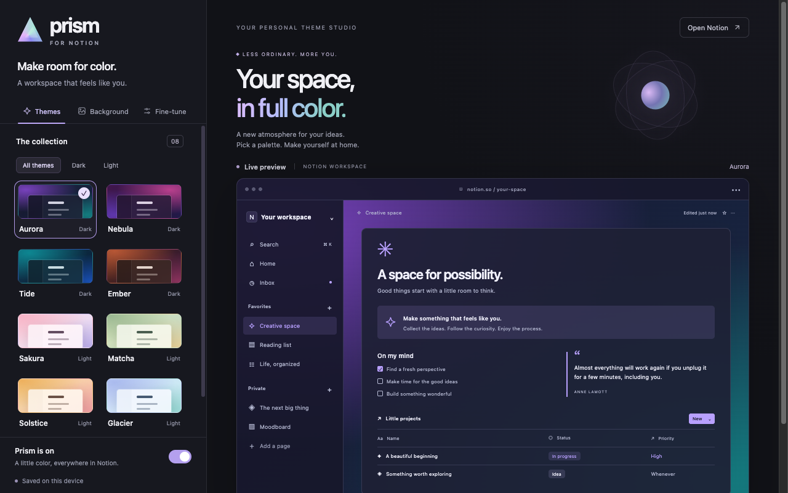

# Prism for Notion

Color themes, image backgrounds, and looping video for the Notion web app. Choose from eight light and dark palettes, or let Prism build a palette from your background. Text, panels, borders, and accents follow the selected theme.



## Install

Prism runs in desktop Chrome 120 or later. There is no build step for the extension.

```sh
git clone https://github.com/NullNaveen/notion-prism.git
```

1. Open `chrome://extensions` and enable **Developer mode**.
2. Click **Load unpacked** and select this repository's `extension` folder.
3. Refresh your Notion tabs.
4. Pin Prism, then click its icon to choose a theme or open **Theme Studio**.

After pulling an update, click **Reload** on Prism's extension card and refresh Notion. Keep the same extension folder to retain your settings.

Opening `extension/studio.html` directly gives you a standalone preview. Its settings are separate from the installed extension; use the toolbar icon to change Notion.

## Themes and backgrounds

The presets are Aurora, Nebula, Tide, Ember, Sakura, Matcha, Solstice, and Glacier. You can adjust the accent color and reading-panel opacity in **Fine-tune**. Turn off **Match document text to the theme** to keep colors chosen inside Notion. Code and artwork keep their own colors.

In **Background**, upload a PNG, JPEG, WebP, AVIF, GIF, MP4, or WebM, or paste a public HTTPS link. Public Pinterest pins and short links are supported when the source allows downloads. Use **Replace image** or **Use a link** to change the background without removing it first.

**Match image** derives the palette locally. **Choose theme** keeps your selected preset when you replace the background.

| Framing            | Result                                                                                     |
| ------------------ | ------------------------------------------------------------------------------------------ |
| Show entire image  | Keeps the original proportions and every edge, with an optional soft backdrop in the gaps. |
| Fill screen (crop) | Covers the window proportionally, cropping as needed.                                      |
| Stretch to screen  | Shows the entire source edge to edge, changing its proportions.                            |

Rotation, positioning, dimming, and blur affect display only. Original files are stored without resizing or recompression. GIFs animate; videos loop silently and can be paused. A small source will still look soft when enlarged.

Files are limited to 20 MB, 48 megapixels, and 16,384 pixels per side. Video playback depends on browser codec support. If a website blocks a link import or requires login, upload the original file instead.

## Compatibility and privacy

Prism applies to `notion.so`, `app.notion.com`, and `notion.site`, including published `notion.site` subdomains. It does not theme Notion's native desktop or mobile apps. Edge and Brave can load Chromium extensions, but this project is tested in Chrome; Firefox and Safari packages are not included.

Settings and backgrounds stay in your browser profile. There is no account, telemetry, backend, or cloud sync. URL imports contact the source hosts you approve. Prism changes the local appearance of the page, not its saved content or what collaborators see. See the [privacy policy](extension/privacy.html).

Notion can change its markup. If a view stops matching the theme, include the affected view, Prism version, and a screenshot with private content removed when reporting it.

## Development

Use Node.js 22 or later and Python 3.

```sh
npm ci
npm test
npm run format:check
npm run package
```

The package command writes `dist/prism-for-notion-<version>.zip` with `manifest.json` at its root. Only `extension/` is included. GitHub Actions runs the tests and uploads the ZIP as a build artifact.

The extension has no runtime dependencies. Prettier is a development dependency; run `npm run format` before committing. See [architecture](docs/architecture.md), [testing](docs/testing.md), and [Chrome Web Store publishing](CHROME_WEB_STORE.md) for more detail.

Prism is an independent project and is not affiliated with Notion, Google, or Pinterest.
